# pokemon-3d-models

Pokémon 3D assets collected from the `holo-pack-h5` project, including **243 deduplicated local GLB files** and **JavaScript source for 31 procedural models**. The GLB files total 132,034,068 bytes (about 125.9 MiB), preserving their original contents, embedded textures, rigs, animations, and author credits.

| Location | Contents |
| --- | --- |
| [`assets/garden/models/`](assets/garden/models/) | 37 GLB files currently used in the garden |
| [`models/supplemental/`](models/supplemental/) | 206 additional GLB files retained from the project's wing animation audit, including regular, Mega, regional, and Gigantamax forms |
| [`garden-models.js`](garden-models.js) | Simplified procedural models for 20 species |
| [`garden-mega-models.js`](garden-mega-models.js) | Simplified procedural models for 11 Mega forms, plus the source mapping for the Mega Malamar GLB |
| [`garden-motion.js`](garden-motion.js), [`garden-pose.js`](garden-pose.js), [`garden-wings.js`](garden-wings.js), [`garden-soft-motion.js`](garden-soft-motion.js) | Helpers for model poses, skeletal animation, wings, and flexible parts |
| [`vendor/`](vendor/) | Three.js, loaders, utilities, and the Draco decoder required by these assets |
| [`assets/garden/species.json`](assets/garden/species.json) | The original project's species, form, and upstream asset catalog |
| [`models-manifest.json`](models-manifest.json) | Paths, sizes, SHA-256 hashes, sources, and embedded metadata for every included GLB |
| [`ATTRIBUTIONS.md`](ATTRIBUTIONS.md) | Author credits, sources, and license statements extracted from the models |
| [`SHA256SUMS`](SHA256SUMS) | Integrity checksums for all 243 GLB files |

Duplicate GLB copies from release directories have been removed. `species.json` also contains remote URLs for assets that have not been downloaded; **a catalog entry does not mean that its model is included in this repository**. See `models-manifest.json` for the exact list of local GLB files.

## Pokémon Model Previews

These screenshots show the actual repository models rendered from a consistent viewing angle. Procedural assets are labeled "Simplified model." Click a Pokémon name to open its GLB file or model generation source. Mega, regional, and Gigantamax forms have separate entries. Koffing's `galar` fan art label and Hoopa's upstream `mega` label are retained in their names and file paths for comparison with the original assets.

### GLB Models (243 Entries)

| Pokédex No. | Pokémon Name | Model Preview |
| ---: | --- | --- |
| #0001 | [Bulbasaur](assets/garden/models/1.glb) | 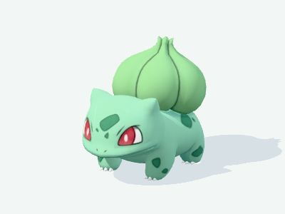 |
| #0004 | [Charmander](assets/garden/models/4.glb) | 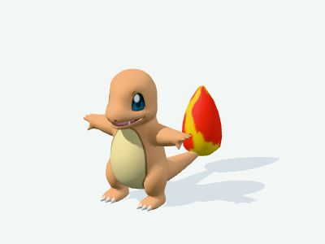 |
| #0006 | [Charizard](assets/garden/models/6.glb) | 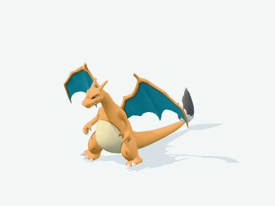 |
| #0006 | [Mega Charizard X](assets/garden/models/6-mega-x.glb) | 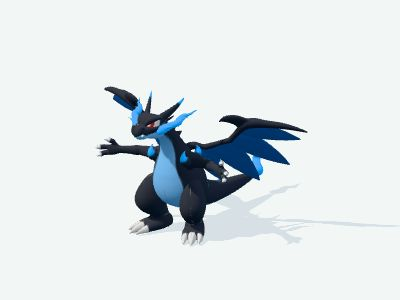 |
| #0006 | [Mega Charizard Y](assets/garden/models/6-mega-y.glb) | 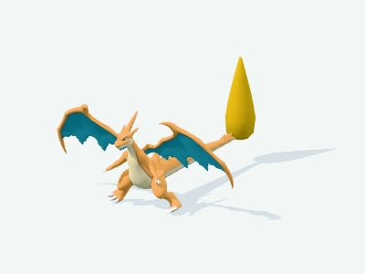 |
| #0006 | [Gigantamax Charizard](models/supplemental/6-gmax.glb) | 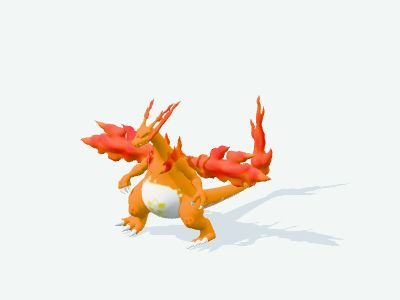 |
| #0007 | [Squirtle](assets/garden/models/7.glb) | 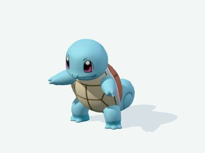 |
| #0012 | [Butterfree](models/supplemental/12-regular.glb) | 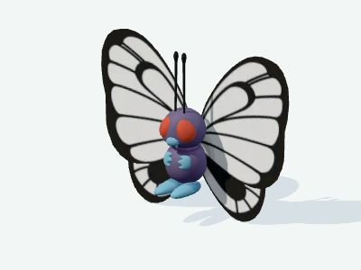 |
| #0012 | [Gigantamax Butterfree](models/supplemental/12-gmax.glb) | 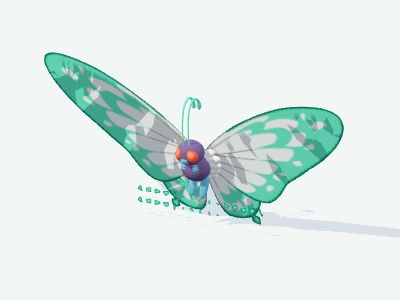 |
| #0015 | [Beedrill](models/supplemental/15-regular.glb) | 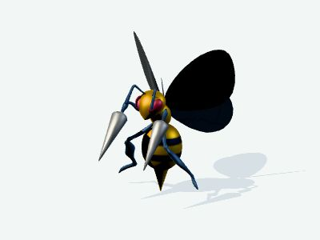 |
| #0015 | [Mega Beedrill](models/supplemental/15-mega.glb) | 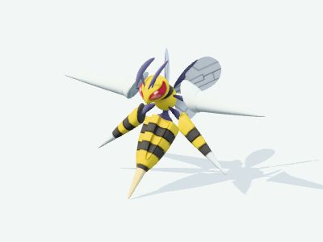 |
| #0016 | [Pidgey](models/supplemental/16-regular.glb) | 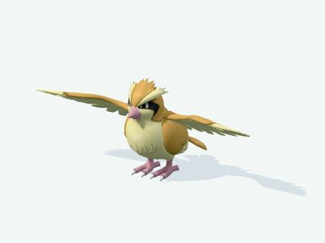 |
| #0017 | [Pidgeotto](models/supplemental/17-regular.glb) | 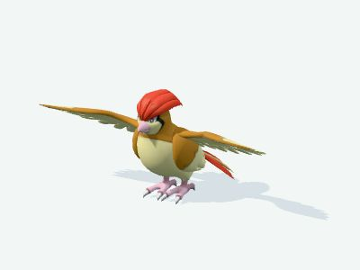 |
| #0018 | [Pidgeot](models/supplemental/18-regular.glb) | 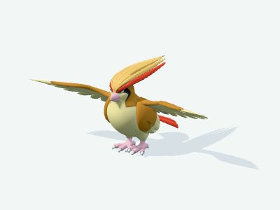 |
| #0018 | [Mega Pidgeot](models/supplemental/18-mega.glb) | 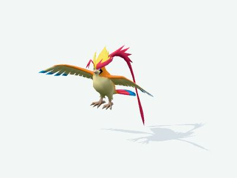 |
| #0021 | [Spearow](models/supplemental/21-regular.glb) | 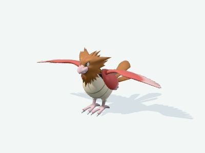 |
| #0022 | [Fearow](models/supplemental/22-regular.glb) | 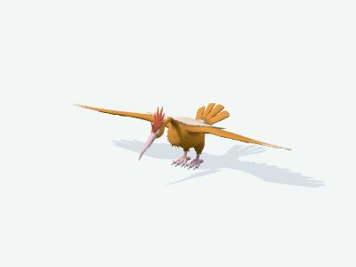 |
| #0025 | [Pikachu](assets/garden/models/25.glb) | 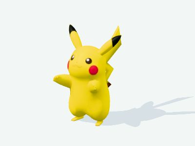 |
| #0041 | [Zubat](models/supplemental/41-regular.glb) | 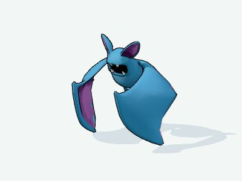 |
| #0042 | [Golbat](models/supplemental/42-regular.glb) | 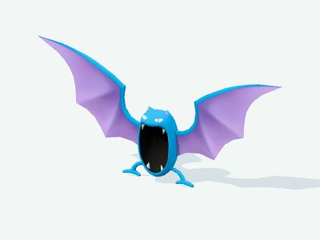 |
| #0049 | [Venomoth](models/supplemental/49-regular.glb) | 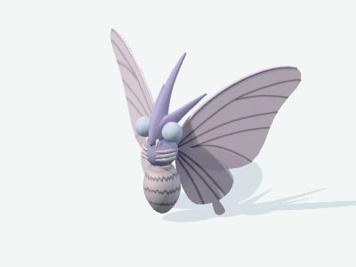 |
| #0054 | [Psyduck](assets/garden/models/54.glb) |  |
| #0081 | [Magnemite](models/supplemental/81-regular.glb) | 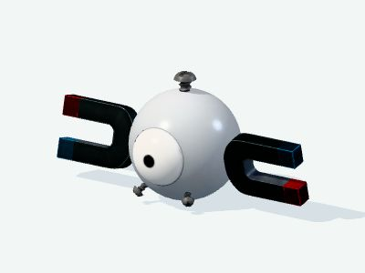 |
| #0082 | [Magneton](models/supplemental/82-regular.glb) | 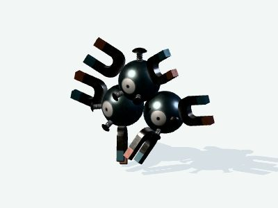 |
| #0083 | [Farfetch’d](models/supplemental/83-regular.glb) | 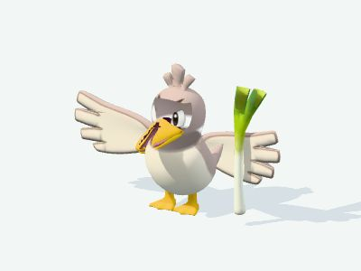 |
| #0084 | [Doduo](models/supplemental/84-regular.glb) | 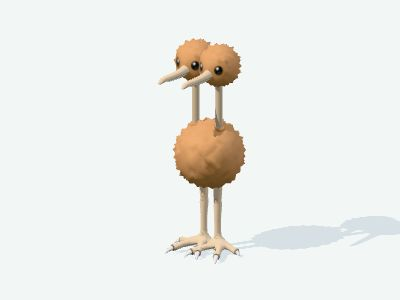 |
| #0085 | [Dodrio](models/supplemental/85-regular.glb) | 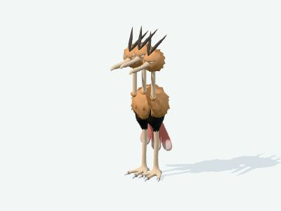 |
| #0092 | [Gastly](models/supplemental/92-regular.glb) | 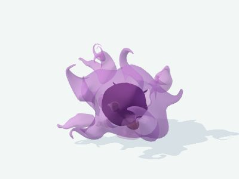 |
| #0093 | [Haunter](models/supplemental/93-regular.glb) |  |
| #0094 | [Gengar](assets/garden/models/94.glb) |  |
| #0094 | [Mega Gengar](models/supplemental/94-mega.glb) |  |
| #0109 | [Koffing](models/supplemental/109-regular.glb) | 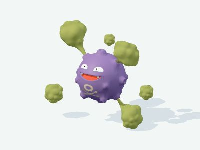 |
| #0109 | [Galarian Koffing (fan art)](models/supplemental/109-galar.glb) | 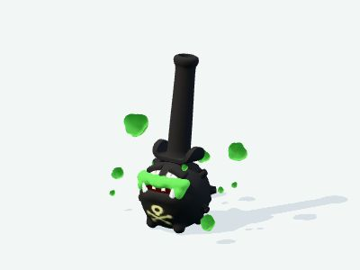 |
| #0110 | [Weezing](models/supplemental/110-regular.glb) | 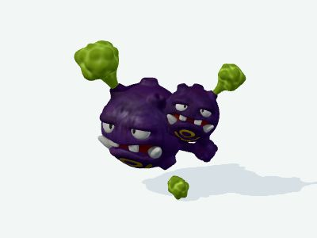 |
| #0123 | [Scyther](models/supplemental/123-regular.glb) | 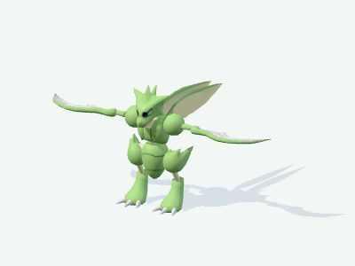 |
| #0127 | [Mega Pinsir](models/supplemental/127-mega.glb) | 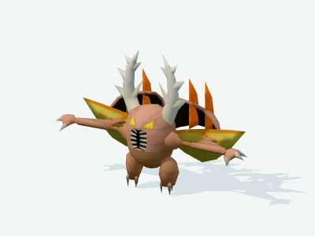 |
| #0129 | [Magikarp](assets/garden/models/129.glb) | 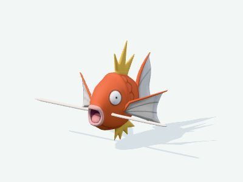 |
| #0130 | [Gyarados](assets/garden/models/130.glb) | 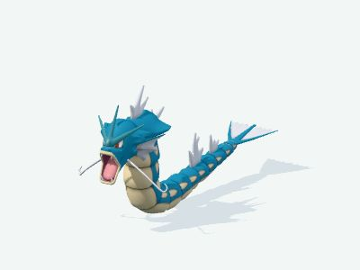 |
| #0130 | [Mega Gyarados](assets/garden/models/130-mega.glb) | 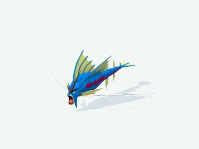 |
| #0133 | [Eevee](assets/garden/models/133.glb) | 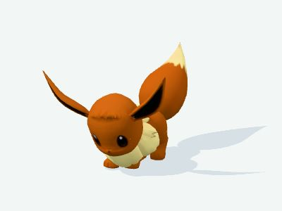 |
| #0137 | [Porygon](models/supplemental/137-regular.glb) | 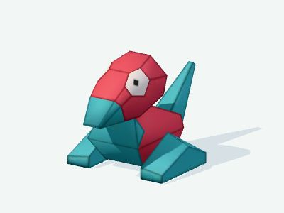 |
| #0142 | [Aerodactyl](models/supplemental/142-regular.glb) | 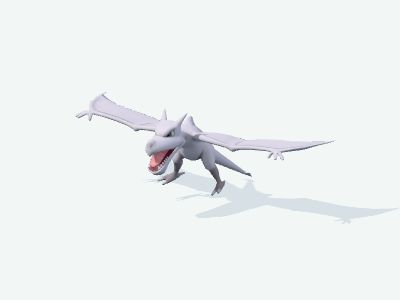 |
| #0142 | [Mega Aerodactyl](models/supplemental/142-mega.glb) | 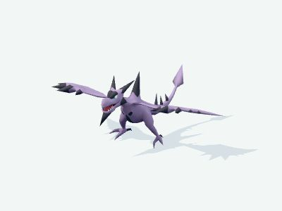 |
| #0144 | [Articuno](assets/garden/models/144.glb) | 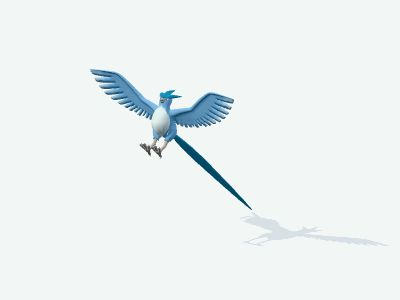 |
| #0144 | [Galarian Articuno](models/supplemental/144-galar.glb) | 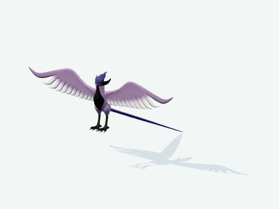 |
| #0145 | [Zapdos](models/supplemental/145-regular.glb) | 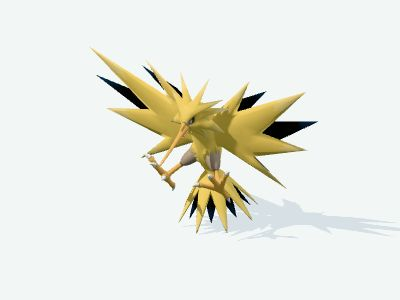 |
| #0145 | [Galarian Zapdos](models/supplemental/145-galar.glb) | 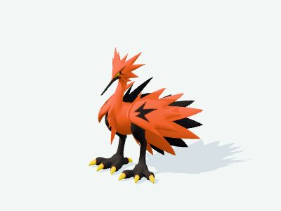 |
| #0146 | [Moltres](models/supplemental/146-regular.glb) | 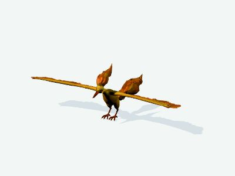 |
| #0146 | [Galarian Moltres](models/supplemental/146-galar.glb) | 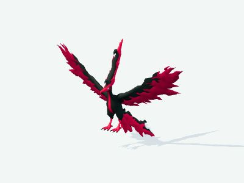 |
| #0149 | [Dragonite](models/supplemental/149-regular.glb) | 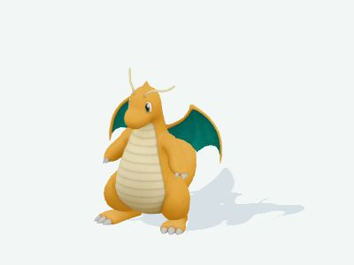 |
| #0150 | [Mewtwo](models/supplemental/150-regular.glb) | 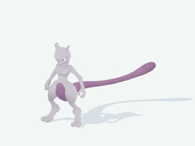 |
| #0150 | [Mega Mewtwo X](models/supplemental/150-mega-x.glb) | 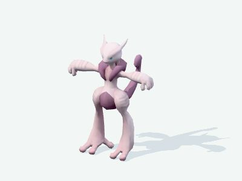 |
| #0150 | [Mega Mewtwo Y](models/supplemental/150-mega-y.glb) | 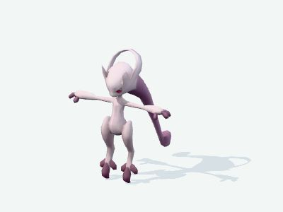 |
| #0151 | [Mew](assets/garden/models/151.glb) | 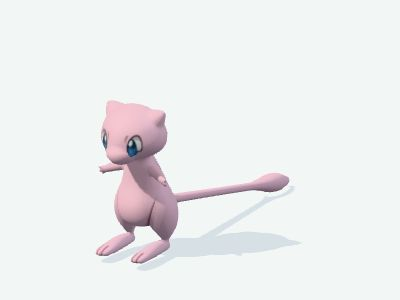 |
| #0152 | [Chikorita](assets/garden/models/152.glb) |  |
| #0155 | [Cyndaquil](assets/garden/models/155.glb) |  |
| #0158 | [Totodile](assets/garden/models/158.glb) |  |
| #0163 | [Hoothoot](models/supplemental/163-regular.glb) |  |
| #0164 | [Noctowl](models/supplemental/164-regular.glb) |  |
| #0165 | [Ledyba](models/supplemental/165-regular.glb) |  |
| #0166 | [Ledian](models/supplemental/166-regular.glb) |  |
| #0169 | [Crobat](models/supplemental/169-regular.glb) |  |
| #0176 | [Togetic](models/supplemental/176-regular.glb) |  |
| #0177 | [Natu](models/supplemental/177-regular.glb) |  |
| #0178 | [Xatu](models/supplemental/178-regular.glb) |  |
| #0183 | [Marill](assets/garden/models/183.glb) |  |
| #0184 | [Azumarill](assets/garden/models/184.glb) |  |
| #0187 | [Hoppip](models/supplemental/187-regular.glb) |  |
| #0188 | [Skiploom](models/supplemental/188-regular.glb) |  |
| #0189 | [Jumpluff](models/supplemental/189-regular.glb) |  |
| #0193 | [Yanma](models/supplemental/193-regular.glb) |  |
| #0198 | [Murkrow](models/supplemental/198-regular.glb) |  |
| #0200 | [Misdreavus](models/supplemental/200-regular.glb) |  |
| #0201 | [Unown](models/supplemental/201-regular.glb) |  |
| #0207 | [Gligar](models/supplemental/207-regular.glb) |  |
| #0212 | [Scizor](models/supplemental/212-regular.glb) |  |
| #0212 | [Mega Scizor](models/supplemental/212-mega.glb) |  |
| #0225 | [Delibird](models/supplemental/225-regular.glb) |  |
| #0227 | [Skarmory](models/supplemental/227-regular.glb) |  |
| #0227 | [Mega Skarmory](models/supplemental/227-mega.glb) |  |
| #0233 | [Porygon2](models/supplemental/233-regular.glb) |  |
| #0249 | [Lugia](assets/garden/models/249.glb) |  |
| #0250 | [Ho-Oh](models/supplemental/250-regular.glb) |  |
| #0251 | [Celebi](models/supplemental/251-regular.glb) |  |
| #0252 | [Treecko](assets/garden/models/252.glb) |  |
| #0255 | [Torchic](assets/garden/models/255.glb) |  |
| #0258 | [Mudkip](assets/garden/models/258.glb) |  |
| #0267 | [Beautifly](models/supplemental/267-regular.glb) |  |
| #0268 | [Cascoon](models/supplemental/268-regular.glb) |  |
| #0269 | [Dustox](models/supplemental/269-regular.glb) |  |
| #0276 | [Taillow](models/supplemental/276-regular.glb) |  |
| #0277 | [Swellow](models/supplemental/277-regular.glb) |  |
| #0278 | [Wingull](models/supplemental/278-regular.glb) |  |
| #0279 | [Pelipper](models/supplemental/279-regular.glb) |  |
| #0280 | [Ralts](assets/garden/models/280.glb) |  |
| #0284 | [Masquerain](models/supplemental/284-regular.glb) |  |
| #0291 | [Ninjask](models/supplemental/291-regular.glb) |  |
| #0292 | [Shedinja](models/supplemental/292-regular.glb) |  |
| #0313 | [Volbeat](models/supplemental/313-regular.glb) |  |
| #0314 | [Illumise](models/supplemental/314-regular.glb) |  |
| #0329 | [Vibrava](models/supplemental/329-regular.glb) |  |
| #0330 | [Flygon](models/supplemental/330-regular.glb) |  |
| #0333 | [Swablu](models/supplemental/333-regular.glb) |  |
| #0334 | [Altaria](models/supplemental/334-regular.glb) |  |
| #0337 | [Lunatone](models/supplemental/337-regular.glb) |  |
| #0338 | [Solrock](models/supplemental/338-regular.glb) |  |
| #0343 | [Baltoy](models/supplemental/343-regular.glb) |  |
| #0344 | [Claydol](models/supplemental/344-regular.glb) |  |
| #0355 | [Duskull](models/supplemental/355-regular.glb) |  |
| #0356 | [Dusclops](models/supplemental/356-regular.glb) |  |
| #0357 | [Tropius](models/supplemental/357-regular.glb) |  |
| #0358 | [Chimecho](models/supplemental/358-regular.glb) |  |
| #0373 | [Salamence](models/supplemental/373-regular.glb) |  |
| #0373 | [Mega Salamence](models/supplemental/373-mega.glb) |  |
| #0374 | [Beldum](models/supplemental/374-regular.glb) |  |
| #0375 | [Metang](models/supplemental/375-regular.glb) |  |
| #0376 | [Metagross](models/supplemental/376-regular.glb) |  |
| #0376 | [Mega Metagross](models/supplemental/376-mega.glb) |  |
| #0380 | [Latias](models/supplemental/380-regular.glb) |  |
| #0380 | [Mega Latias](models/supplemental/380-mega.glb) |  |
| #0381 | [Latios](models/supplemental/381-regular.glb) |  |
| #0381 | [Mega Latios](models/supplemental/381-mega.glb) |  |
| #0383 | [Groudon](assets/garden/models/383.glb) |  |
| #0384 | [Rayquaza](assets/garden/models/384.glb) |  |
| #0384 | [Mega Rayquaza](assets/garden/models/384-mega.glb) |  |
| #0385 | [Jirachi](models/supplemental/385-regular.glb) |  |
| #0386 | [Deoxys](models/supplemental/386-regular.glb) |  |
| #0396 | [Starly](models/supplemental/396-regular.glb) |  |
| #0397 | [Staravia](models/supplemental/397-regular.glb) |  |
| #0398 | [Staraptor](models/supplemental/398-regular.glb) |  |
| #0414 | [Mothim](models/supplemental/414-regular.glb) |  |
| #0415 | [Combee](models/supplemental/415-regular.glb) |  |
| #0416 | [Vespiquen](models/supplemental/416-regular.glb) |  |
| #0425 | [Drifloon](models/supplemental/425-regular.glb) |  |
| #0426 | [Drifblim](models/supplemental/426-regular.glb) |  |
| #0429 | [Mismagius](models/supplemental/429-regular.glb) |  |
| #0430 | [Honchkrow](models/supplemental/430-regular.glb) |  |
| #0433 | [Chingling](models/supplemental/433-regular.glb) |  |
| #0436 | [Bronzor](models/supplemental/436-regular.glb) |  |
| #0437 | [Bronzong](models/supplemental/437-regular.glb) |  |
| #0441 | [Chatot](models/supplemental/441-regular.glb) |  |
| #0447 | [Riolu](assets/garden/models/447.glb) |  |
| #0448 | [Lucario](assets/garden/models/448.glb) |  |
| #0455 | [Carnivine](models/supplemental/455-regular.glb) |  |
| #0462 | [Magnezone](models/supplemental/462-regular.glb) |  |
| #0468 | [Togekiss](models/supplemental/468-regular.glb) |  |
| #0469 | [Yanmega](models/supplemental/469-regular.glb) |  |
| #0472 | [Gliscor](models/supplemental/472-regular.glb) |  |
| #0474 | [Porygon-Z](models/supplemental/474-regular.glb) |  |
| #0477 | [Dusknoir](models/supplemental/477-regular.glb) |  |
| #0478 | [Froslass](models/supplemental/478-regular.glb) |  |
| #0479 | [Rotom](models/supplemental/479-regular.glb) |  |
| #0480 | [Uxie](models/supplemental/480-regular.glb) |  |
| #0481 | [Mesprit](models/supplemental/481-regular.glb) |  |
| #0482 | [Azelf](models/supplemental/482-regular.glb) |  |
| #0487 | [Giratina](models/supplemental/487-regular.glb) |  |
| #0488 | [Cresselia](models/supplemental/488-regular.glb) |  |
| #0491 | [Darkrai](models/supplemental/491-regular.glb) |  |
| #0491 | [Mega Darkrai](models/supplemental/491-mega.glb) |  |
| #0493 | [Arceus](models/supplemental/493-regular.glb) |  |
| #0494 | [Victini](models/supplemental/494-regular.glb) |  |
| #0519 | [Pidove](models/supplemental/519-regular.glb) |  |
| #0520 | [Tranquill](models/supplemental/520-regular.glb) |  |
| #0521 | [Unfezant](models/supplemental/521-regular.glb) |  |
| #0527 | [Woobat](models/supplemental/527-regular.glb) |  |
| #0528 | [Swoobat](models/supplemental/528-regular.glb) |  |
| #0561 | [Sigilyph](models/supplemental/561-regular.glb) |  |
| #0562 | [Yamask](models/supplemental/562-regular.glb) |  |
| #0563 | [Cofagrigus](models/supplemental/563-regular.glb) |  |
| #0566 | [Archen](models/supplemental/566-regular.glb) |  |
| #0567 | [Archeops](models/supplemental/567-regular.glb) |  |
| #0571 | [Zoroark](assets/garden/models/571.glb) |  |
| #0577 | [Solosis](models/supplemental/577-regular.glb) |  |
| #0578 | [Duosion](models/supplemental/578-regular.glb) |  |
| #0579 | [Reuniclus](models/supplemental/579-regular.glb) |  |
| #0580 | [Ducklett](models/supplemental/580-regular.glb) |  |
| #0581 | [Swanna](models/supplemental/581-regular.glb) |  |
| #0587 | [Emolga](models/supplemental/587-regular.glb) |  |
| #0599 | [Klink](models/supplemental/599-regular.glb) |  |
| #0600 | [Klang](models/supplemental/600-regular.glb) |  |
| #0601 | [Klinklang](models/supplemental/601-regular.glb) |  |
| #0602 | [Tynamo](models/supplemental/602-regular.glb) |  |
| #0603 | [Eelektrik](models/supplemental/603-regular.glb) |  |
| #0604 | [Eelektross](models/supplemental/604-regular.glb) |  |
| #0605 | [Elgyem](models/supplemental/605-regular.glb) |  |
| #0606 | [Beheeyem](models/supplemental/606-regular.glb) |  |
| #0607 | [Litwick](models/supplemental/607-regular.glb) |  |
| #0608 | [Lampent](models/supplemental/608-regular.glb) |  |
| #0609 | [Chandelure](models/supplemental/609-regular.glb) |  |
| #0615 | [Cryogonal](models/supplemental/615-regular.glb) |  |
| #0623 | [Golurk](models/supplemental/623-regular.glb) |  |
| #0627 | [Rufflet](models/supplemental/627-regular.glb) |  |
| #0628 | [Braviary](models/supplemental/628-regular.glb) |  |
| #0628 | [Hisuian Braviary](models/supplemental/628-hisui.glb) |  |
| #0629 | [Vullaby](models/supplemental/629-regular.glb) |  |
| #0630 | [Mandibuzz](models/supplemental/630-regular.glb) |  |
| #0635 | [Hydreigon](models/supplemental/635-regular.glb) |  |
| #0637 | [Volcarona](models/supplemental/637-regular.glb) |  |
| #0641 | [Tornadus](models/supplemental/641-regular.glb) |  |
| #0642 | [Thundurus](models/supplemental/642-regular.glb) |  |
| #0645 | [Landorus](models/supplemental/645-regular.glb) |  |
| #0655 | [Mega Delphox](models/supplemental/655-mega.glb) |  |
| #0658 | [Greninja](assets/garden/models/658.glb) |  |
| #0658 | [Mega Greninja](assets/garden/models/658-mega.glb) |  |
| #0661 | [Fletchling](models/supplemental/661-regular.glb) |  |
| #0662 | [Fletchinder](models/supplemental/662-regular.glb) |  |
| #0663 | [Talonflame](models/supplemental/663-regular.glb) |  |
| #0666 | [Vivillon](models/supplemental/666-regular.glb) |  |
| #0679 | [Honedge](models/supplemental/679-regular.glb) |  |
| #0680 | [Doublade](models/supplemental/680-regular.glb) |  |
| #0681 | [Aegislash](models/supplemental/681-regular.glb) |  |
| #0687 | [Mega Malamar](assets/garden/models/687-mega.glb) |  |
| #0700 | [Sylveon](assets/garden/models/700.glb) |  |
| #0701 | [Hawlucha](models/supplemental/701-regular.glb) |  |
| #0707 | [Klefki](models/supplemental/707-regular.glb) |  |
| #0714 | [Noibat](models/supplemental/714-regular.glb) |  |
| #0715 | [Noivern](models/supplemental/715-regular.glb) |  |
| #0717 | [Yveltal](models/supplemental/717-regular.glb) |  |
| #0718 | [Zygarde](assets/garden/models/718.glb) |  |
| #0718 | [Mega Zygarde](assets/garden/models/718-mega.glb) |  |
| #0720 | [Hoopa](models/supplemental/720-regular.glb) |  |
| #0720 | [Hoopa (upstream: mega)](models/supplemental/720-mega.glb) |  |
| #0722 | [Rowlet](models/supplemental/722-regular.glb) |  |
| #0723 | [Dartrix](models/supplemental/723-regular.glb) |  |
| #0731 | [Pikipek](models/supplemental/731-regular.glb) |  |
| #0732 | [Trumbeak](models/supplemental/732-regular.glb) |  |
| #0733 | [Toucannon](models/supplemental/733-regular.glb) |  |
| #0738 | [Vikavolt](models/supplemental/738-regular.glb) |  |
| #0741 | [Oricorio](models/supplemental/741-regular.glb) |  |
| #0743 | [Ribombee](models/supplemental/743-regular.glb) |  |
| #0774 | [Minior](models/supplemental/774-regular.glb) |  |
| #0786 | [Tapu Lele](models/supplemental/786-regular.glb) |  |
| #0789 | [Cosmog](models/supplemental/789-regular.glb) |  |
| #0790 | [Cosmoem](models/supplemental/790-regular.glb) |  |
| #0797 | [Celesteela](models/supplemental/797-regular.glb) |  |
| #0821 | [Rookidee](models/supplemental/821-regular.glb) |  |
| #0822 | [Corvisquire](models/supplemental/822-regular.glb) |  |
| #0823 | [Corviknight](models/supplemental/823-regular.glb) |  |
| #0845 | [Cramorant](models/supplemental/845-regular.glb) |  |
| #0905 | [Enamorus](models/supplemental/905-regular.glb) |  |
| #0941 | [Kilowattrel](models/supplemental/941-regular.glb) |  |
| #0962 | [Bombirdier](models/supplemental/962-regular.glb) |  |
| #0973 | [Flamigo](models/supplemental/973-regular.glb) |  |

### Procedural Models (31 Entries)

These simplified models come from the original project. Their screenshots show the geometry generated by JavaScript. Click a name to view the generation source.

| Pokédex No. | Pokémon Name | Model Preview |
| ---: | --- | --- |
| #0036 | [Mega Clefable](garden-mega-models.js)<br><sub>Simplified model</sub> |  |
| #0149 | [Mega Dragonite](garden-mega-models.js)<br><sub>Simplified model</sub> |  |
| #0478 | [Mega Froslass](garden-mega-models.js)<br><sub>Simplified model</sub> |  |
| #0560 | [Mega Scrafty](garden-mega-models.js)<br><sub>Simplified model</sub> |  |
| #0609 | [Mega Chandelure](garden-mega-models.js)<br><sub>Simplified model</sub> |  |
| #0623 | [Mega Golurk](garden-mega-models.js)<br><sub>Simplified model</sub> |  |
| #0668 | [Mega Pyroar](garden-mega-models.js)<br><sub>Simplified model</sub> |  |
| #0691 | [Mega Dragalge](garden-mega-models.js)<br><sub>Simplified model</sub> |  |
| #0701 | [Mega Hawlucha](garden-mega-models.js)<br><sub>Simplified model</sub> |  |
| #0768 | [Mega Golisopod](garden-mega-models.js)<br><sub>Simplified model</sub> |  |
| #0850 | [Sizzlipede](garden-models.js)<br><sub>Simplified model</sub> |  |
| #0851 | [Centiskorch](garden-models.js)<br><sub>Simplified model</sub> |  |
| #0861 | [Grimmsnarl](garden-models.js)<br><sub>Simplified model</sub> |  |
| #0868 | [Milcery](garden-models.js)<br><sub>Simplified model</sub> |  |
| #0873 | [Frosmoth](garden-models.js)<br><sub>Simplified model</sub> |  |
| #0918 | [Spidops](garden-models.js)<br><sub>Simplified model</sub> |  |
| #0919 | [Nymble](garden-models.js)<br><sub>Simplified model</sub> |  |
| #0935 | [Charcadet](garden-models.js)<br><sub>Simplified model</sub> |  |
| #0936 | [Armarouge](garden-models.js)<br><sub>Simplified model</sub> |  |
| #0938 | [Tadbulb](garden-models.js)<br><sub>Simplified model</sub> |  |
| #0939 | [Bellibolt](garden-models.js)<br><sub>Simplified model</sub> |  |
| #0940 | [Wattrel](garden-models.js)<br><sub>Simplified model</sub> |  |
| #0944 | [Shroodle](garden-models.js)<br><sub>Simplified model</sub> |  |
| #0963 | [Finizen](garden-models.js)<br><sub>Simplified model</sub> |  |
| #0964 | [Palafin](garden-models.js)<br><sub>Simplified model</sub> |  |
| #0971 | [Greavard](garden-models.js)<br><sub>Simplified model</sub> |  |
| #0972 | [Houndstone](garden-models.js)<br><sub>Simplified model</sub> |  |
| #0978 | [Mega Tatsugiri](garden-mega-models.js)<br><sub>Simplified model</sub> |  |
| #1012 | [Poltchageist](garden-models.js)<br><sub>Simplified model</sub> |  |
| #1013 | [Sinistcha](garden-models.js)<br><sub>Simplified model</sub> |  |
| #1024 | [Terapagos](garden-models.js)<br><sub>Simplified model</sub> |  |

## Using GLB Files

Serve the repository files over HTTP and use a loader that supports glTF 2.0. All GLB files use `KHR_draco_mesh_compression`, and 238 also require `EXT_texture_webp` support. Textures and buffers are embedded in the model files; the Draco decoder must still be loaded separately.

The following code can be used in an ES module page served from the repository root:

```js
import { GLTFLoader } from './vendor/three-addons/loaders/GLTFLoader.js';
import { DRACOLoader } from './vendor/three-addons/loaders/DRACOLoader.js';

const draco = new DRACOLoader();
draco.setDecoderPath('./vendor/three-addons/libs/draco/');
const loader = new GLTFLoader().setDRACOLoader(draco);
const gltf = await loader.loadAsync('./assets/garden/models/25.glb');
// Add gltf.scene to your scene; animations are available in gltf.animations.
```

Models retain their original coordinate systems, scales, and animation names. The original project's `prepareRig()` applies an X-axis correction of `-Math.PI / 2` to regular Pikachu and handles other poses and additional motion at runtime. These runtime effects are not baked into the GLB files.

## Using Procedural Models

```js
import { createStylizedModel } from './garden-models.js';
import { createMegaModel } from './garden-mega-models.js';

const stylized = createStylizedModel(940);
const mega = createMegaModel({ id: 149, form: 'mega' });
// Both return values contain scene and animations.
```

These 31 models are preserved as source code and have not been exported to GLB. They are simplified geometry created for the original project, with a different visual style from the upstream GLB models.

## Sources and Licensing

The upstream GLB collection comes from [Pokemon-3D-api/assets](https://github.com/Pokemon-3D-api/assets), pinned to revision `429de1288cea0d43f5b4f56305d2276e94239d65`. The GLB contents were not modified during this upload.

The repository's [MIT License](LICENSE) does not replace the author licenses retained in individual models. A total of 126 GLB files explicitly embed the following statements:

| Embedded License | Count | Main Conditions |
| --- | ---: | --- |
| [CC BY 4.0](https://creativecommons.org/licenses/by/4.0/) | 123 | Give attribution, link the license, and indicate changes |
| [CC BY-NC 4.0](https://creativecommons.org/licenses/by-nc/4.0/) | 2 | The attribution conditions above, plus a restriction to noncommercial use |
| [CC BY-NC-SA 4.0](https://creativecommons.org/licenses/by-nc-sa/4.0/) | 1 | The attribution and noncommercial conditions above; distribute adaptations under the same license |

The noncommercial licenses apply to [`41-regular.glb`](models/supplemental/41-regular.glb) (Zubat), [`81-regular.glb`](models/supplemental/81-regular.glb) (Magnemite), and [`789-regular.glb`](models/supplemental/789-regular.glb) (Cosmog, which uses NC-SA). The absence of these embedded statements in other files does not imply that all models share the repository's MIT license. Preserve the credits and applicable conditions recorded for each file in [`ATTRIBUTIONS.md`](ATTRIBUTIONS.md), [`models-manifest.json`](models-manifest.json), and [`THIRD_PARTY_NOTICES.md`](THIRD_PARTY_NOTICES.md).

Pokémon characters, names, designs, and related trademarks belong to Nintendo, Creatures, GAME FREAK, The Pokémon Company, and their respective rights holders. This is an unofficial asset collection with no affiliation, sponsorship, or endorsement from those rights holders.
